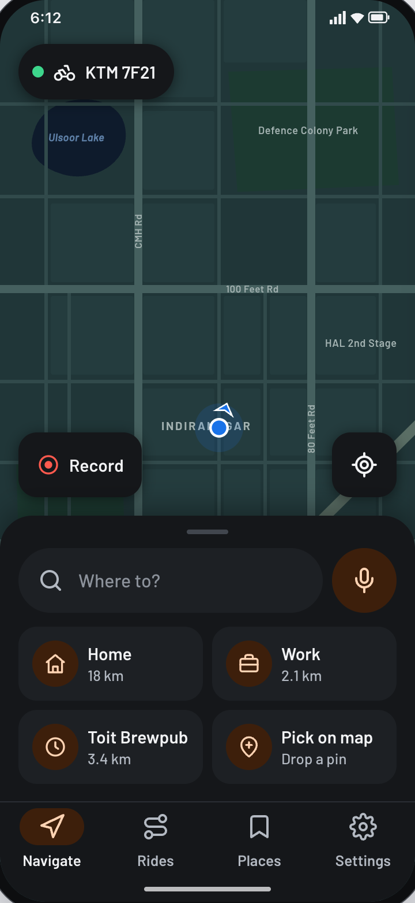
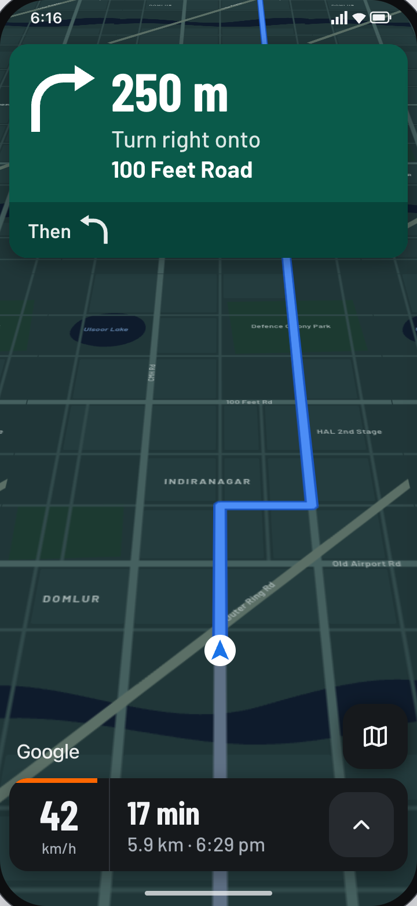
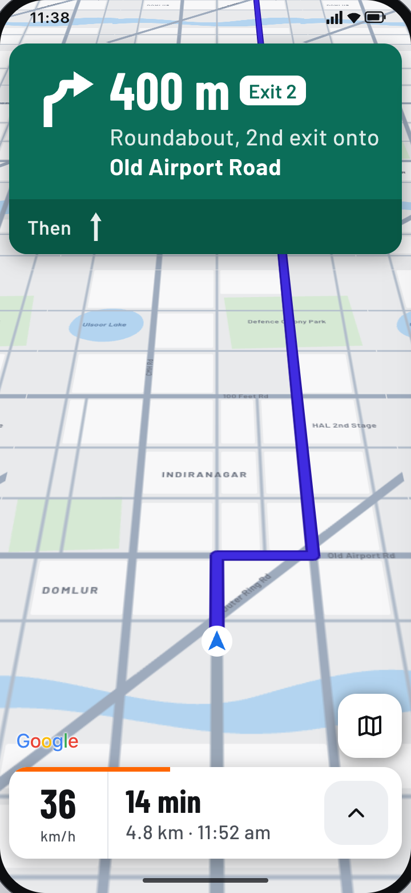
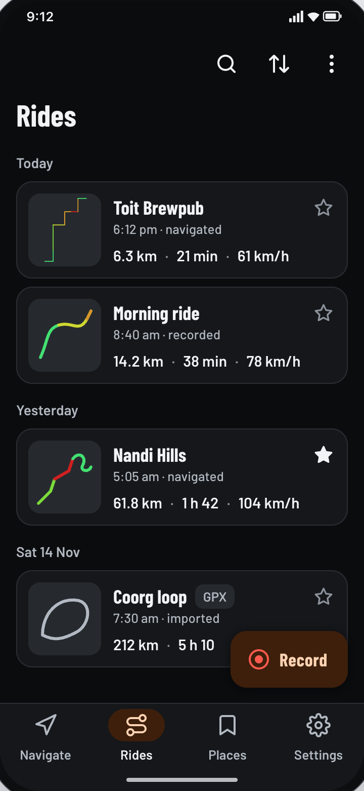
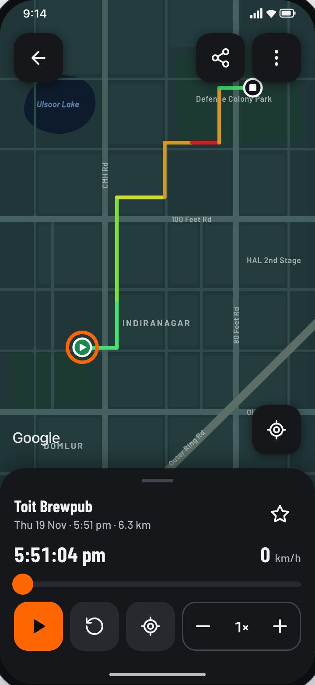

<p align="center">
  
</p>

<h1 align="center">KTM Navigator</h1>

<p align="center">
  <b>Turn-by-turn navigation on your KTM or Husqvarna Gen-3 dash. Free, private, and built for riding.</b>
</p>

<p align="center">
  <i>An independent open-source app. Not affiliated with or endorsed by KTM or Husqvarna.</i>
</p>

<p align="center">
  <a href="../../releases/latest"><b>Download the latest APK</b></a>
</p>

<p align="center">
  
  
  
  
  
</p>
<p align="center"><sub>Design mocks of the app's main screens.</sub></p>

---

## What it does

Pick one of two engines in **Settings → Navigation**:

| Engine | How it works |
|---|---|
| **In-app maps** (Google) | Search, drop a pin or share a Maps link, preview routes, then ride with guidance on the phone and the dash. Needs your own Google API key and internet. |
| **Notification mirror** | Navigate in Google Maps as usual. The app copies its turns to the dash over Bluetooth. Works offline, and is the default when there is no API key. |

## Features

- **Dash guidance:** turn arrow, distance, road name and ETA on the Gen-3 display. An on-device model reads Google Maps' arrow icons, since Maps sends no turn text.
- **Silent reconnect:** pair once, then the dash reconnects by itself after every ignition cycle.
- **Made for riding:** large controls, a maneuver card you can read at a glance, and Day/Night modes for gloves and sunlight.
- **Trip planning:** alternate routes with traffic delay, stops, saved places, Home and Work shortcuts.
- **Rides:** every trip is recorded on the phone. Browse, search, replay up to 64×, trim and merge them.
- **Phone messages on the dash**, with group chats filtered out and a one-tap mute.
- **Turn beeps** (left ear for left turns, right ear for right) and a loud **overspeed alert**.
- **Offline-safe:** guidance keeps running without signal, and recording never stops.
- **Diagnostics:** symbol tests, turn-icon calibration and shareable logs.

## Privacy

- No accounts, no analytics, no ads, and no server of ours.
- The notification-mirror engine stays on the phone. It only reads Maps' notification and sends text over Bluetooth.
- The in-app maps engine goes online. Your destination and location are sent to Google's Navigation SDK.

## Compatibility

- Android 16 or newer.
- Tested on a **KTM 390 Adventure (2025)**. Other 2020+ Gen-3 bikes should work. 1290, 890, SMC and Husqvarna are lightly tested or untested.
- The bike's connectivity / Tech Pack may need to be active for the dash to offer navigation.
- First pairing needs the "add device" confirmation on the dash, once per bike.
- On Android 16, enable **Allow restricted settings** (App info → ⋮) before granting notification access to a sideloaded app.

## Known issues

- Turn-icon accuracy depends on your Maps version and dash. Fix wrong icons with Symbol Test and Turn-icon Calibration.
- Alternate-route choice may snap to the fastest route while you are standing still.
- Live telemetry (RPM, gear, fuel, TPMS) is not available. The dash rejects the writes.

## Install

Download the APK from the [latest release](../../releases/latest), open it on your phone and allow installs from unknown sources. Then:

1. Turn on **Notification access**.
2. Turn off battery optimisation for the app, so it stays connected.

## Build

You need Android Studio (or the command-line SDK) and JDK 17.

```bash
echo "sdk.dir=$HOME/Library/Android/sdk" > local.properties   # Linux: $HOME/Android/Sdk
./gradlew :app:assembleDebug
adb install -r app/build/outputs/apk/debug/app-debug.apk
```

### Google API key (for the in-app maps engine)

Without a key the app still builds, but runs only in notification-mirror mode.

1. In the [Google Cloud Console](https://console.cloud.google.com), enable billing and these four APIs: **Navigation SDK for Android**, **Maps SDK for Android**, **Routes API**, **Places API (New)**.
2. Create an API key and restrict it:
   - **Android apps:** package `com.navigator.ktm` plus the SHA-1 of the keystore that signs your APK.
   - **APIs:** only the four above.
3. Add it to `local.properties` and rebuild:

   ```properties
   NAV_SDK_API_KEY=your-key
   ```

Get the SHA-1 with `keytool -list -v -alias androiddebugkey -keystore ~/.android/debug.keystore -storepass android | grep SHA1`. Add both your debug and release fingerprints if you use both. If search or routes fail while everything else works, the SHA-1 is almost always the cause.

## Docs

- [Architecture](docs/architecture.md)
- [Design system](docs/design-system.md)
- [Engineering notes](docs/ENGINEERING_NOTES.md)
- [Dash BLE protocol](docs/BCCU_BLE_PROTOCOL.md)
- [Turn-icon model](ml/README.md): trained on Google Maps' own icons, reproducible with `ml/train_maneuver_model.py`
- [Changelog](CHANGELOG.md)

## Contributing

Help is welcome, whether you ride one of these bikes or just like Android and BLE work. Good places to start:

- Live telemetry over the dash's PRPC channel.
- A second connection path for older "MY RIDE" bikes.
- Testing on a Husqvarna and on other Gen-3 bikes and firmware.
- Better turn-icon training data, UI polish, docs and translations.

Open an [issue](../../issues) with logs from **Settings → Diagnostics**, or send a pull request. Please keep the core promise: **on-device only, no data collection.**

## Disclaimer

Unofficial hobby project, provided as-is with no warranty. Ride responsibly and do not use your phone while riding.

## License

[MIT](LICENSE)
